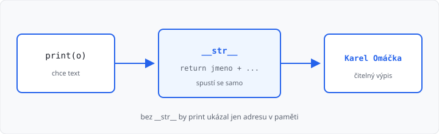
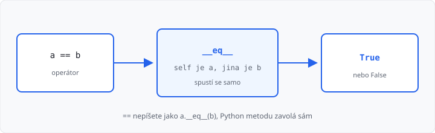

# Speciální metody

Lekce má **3 hodiny**. Navazuje na [metody](../05-metody/lekce.md).

Minule jste psali `print(o.cele_jmeno())`. Když vypíšete **celý objekt**, Python ukáže jen typ a adresu v paměti. **`__str__`** to změní: `print(o)` vypíše čitelný text. Stejně fungují další speciální metody: `==` zavolá **`__eq__`**, `len()` zavolá **`__len__`**.

Souhrn těchto lekcí je [lekce 07](../07-tridy-procviceni/lekce.md). Dědičnost je lekce 08. Iterace (`__iter__`) je [lekce 11](../11-vyjimky-a-iterace/lekce.md).

## Cíle lekce

- Napíšete `__str__`, která **vrátí** řetězec (ne `print` uvnitř)
- Pochopíte, že `print(o)` a `str(o)` tu metodu **zavolají samy**
- Napíšete `__eq__`, aby `==` porovnal **údaje**, ne jen „je to tentýž objekt“
- Napíšete `__len__`, aby `len(objekt)` vrátil počet prvků

## Proč print(o) nic neřekne

```python
class Osoba:
    def __init__(self, jmeno, prijmeni):
        self.jmeno = jmeno
        self.prijmeni = prijmeni


o = Osoba("Karel", "Omáčka")
print(o)  # <__main__.Osoba object at 0x...>
```

To k čtení není. Python neví, které atributy má složit do věty — to musíte napsat vy.

## Speciální metoda `__str__`

Metoda se dvěma podtržítky z obou stran je **speciální** (čtěte „dunder str“). Nesvoláváte ji sami. Spustí se, když objekt potřebujete jako **text**: `print(o)`, `str(o)`, nebo skládání řetězců.

```python
class Osoba:
    def __init__(self, jmeno, prijmeni):
        self.jmeno = jmeno
        self.prijmeni = prijmeni

    def __str__(self):
        return self.jmeno + " " + self.prijmeni


o = Osoba("Karel", "Omáčka")
print(o)       # Karel Omáčka
s = str(o)     # totéž do proměnné
print(s)
```

`return` je povinný a musí vrátit **řetězec**. Když uvnitř `__str__` použijete `print` a nic nevrátíte, `print(o)` vypíše `None`.



→ viz `priklady/osoba.py`

`__init__` už znáte — taky speciální metoda. Vzor je pořád stejný: běžný zápis (`print`, `==`, `len`) metodu spustí, tečkou ji nevoláte.

## Objekt uvnitř objektu

Když má osoba adresu, v `__str__` osoby použijete `str(self.adresa)` — tím se spustí `__str__` adresy:

```python
class Adresa:
    def __init__(self, ulice, mesto):
        self.ulice = ulice
        self.mesto = mesto

    def __str__(self):
        return self.ulice + ", " + self.mesto


class Osoba:
    def __init__(self, jmeno, adresa):
        self.jmeno = jmeno
        self.adresa = adresa

    def __str__(self):
        return self.jmeno + ", " + str(self.adresa)


o = Osoba("Karel", Adresa("Komenskeho 12", "Brno"))
print(o)  # Karel, Komenskeho 12, Brno
```

→ viz `priklady/osoba_a_adresa.py`

## Rovnost — `__eq__`

Dva objekty se stejným názvem nejsou jeden objekt. Bez `__eq__` operátor `==` porovná, jestli jde o **tentýž** objekt v paměti:

```python
class Kniha:
    def __init__(self, nazev):
        self.nazev = nazev


a = Kniha("R.U.R.")
b = Kniha("R.U.R.")
print(a == b)  # False
print(a == a)  # True
```

`a` a `b` mají stejný název, přesto je `a == b` nepravda. `a == a` je pravda, protože vlevo i vpravo je jeden objekt.

`__eq__` určí, podle jakého údaje se rovnají. Druhý parametr je objekt **vpravo** od `==`. Návrat je `True` nebo `False`:

```python
class Kniha:
    def __init__(self, nazev):
        self.nazev = nazev

    def __eq__(self, jina):
        return self.nazev == jina.nazev


a = Kniha("R.U.R.")
b = Kniha("R.U.R.")
c = Kniha("Válka s Mloky")
print(a == b)  # True
print(a == c)  # False
```

`a == b` znamená: `self` je `a`, `jina` je `b`. `__eq__` sami nepíšete do volání — stejně jako `__str__` u `print`.

`!=` je opak. Když `__eq__` existuje, `a != c` vyjde `True` a druhou metodu pro to psát nemusíte.

Vpravo musí být taky kniha. `a == "R.U.R."` spadne na `AttributeError`, protože řetězec nemá atribut `nazev`.



→ viz `priklady/kniha_eq.py`

## Délka — `__len__`

`len(seznam)` znáte z [1. ročníku](../../1-rocnik/16-seznamy/lekce.md). U vlastního objektu `len` zavolá `__len__`. Ta vrátí **celé číslo od nuly výš** — kolik prvků objekt drží.

```python
class Policka:
    def __init__(self):
        self.knihy = []

    def pridej(self, kniha):
        self.knihy.append(kniha)

    def __len__(self):
        return len(self.knihy)


p = Policka()
p.pridej(Kniha("R.U.R."))
p.pridej(Kniha("Válka s Mloky"))
print(len(p))  # 2
```

`pridej` je obyčejná metoda z minula. `__len__` jen vrátí, kolik knih v seznamu je. Prázdná polička má `len` nula. Když metoda vrátí text nebo záporné číslo, `len(p)` spadne.

→ viz `priklady/policka.py`

Python má i další speciální metody (`__lt__` pro `<`, `__repr__` pro ladicí výpis). V této lekci stačí `__str__`, `__eq__` a `__len__`.

## Časté chyby

| Chyba | Následek |
|-------|----------|
| `__str` (málo podtržítek) | `print(o)` pořád ukáže adresu |
| `print(...)` uvnitř `__str__` bez `return` | vypíše se `None` |
| `return` čísla místo textu | `TypeError: __str__ returned non-string` |
| `return self` | totéž — musí to být `str` |
| voláte `o.__str__()` ručně | zbytečné, stačí `print(o)` |
| `__eq__` nic nevrátí | `==` vyjde `False` |
| `self.nazev == jina` | text srovnáváte s celým objektem, vyjde `False` |
| `__len__` vrátí text | `TypeError` u `len(objekt)` |

## Shrnutí

| Pojem | Význam |
|-------|--------|
| speciální metoda | jméno s `__` z obou stran, volá ji Python |
| `__str__` | textová podoba objektu |
| `print(o)` / `str(o)` | spustí `__str__` |
| `__eq__` | podle čeho platí `==` |
| `a == b` | spustí `__eq__`, vpravo je druhý parametr |
| `__len__` | počet prvků pro `len(objekt)` |

Příště souhrn — třídu, konstruktor, metodu a speciální metody složíte do jednoho programu.

Automatický test v AMOS u cvičných úkolů kontroluje **výstup**.

## Co dál

→ [Lekce 07: Třídy — souhrn a procvičení](../07-tridy-procviceni/lekce.md)
