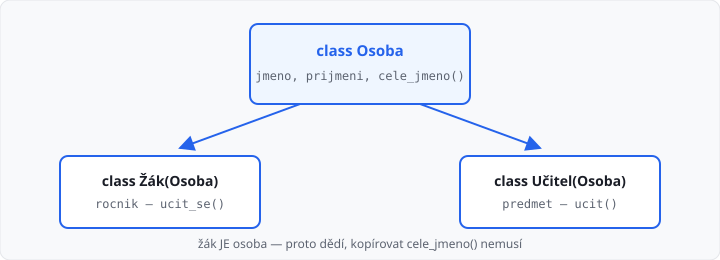

# Dědičnost

Lekce má **5 hodin** (jeden týden). Navazuje na [souhrn tříd](../07-tridy-procviceni/lekce.md).

Když dvě třídy mají spoustu **stejného** kódu (atributy, metody) a platí, že jedna věc **je** druhá (žák **je** osoba), společné věci napíšete jednou u **rodiče**. Potomek je zdědí a přidá jen to svoje.

Přepisování stejné metody u více potomků (polymorfismus) je až lekce 09. Tady jde o vztah rodič → potomek a `super()`.

## Cíle lekce

- Pochopíte dědičnost jako vztah **„je“**, ne „má“
- Potomek **zavolá** metodu, kterou napsal rodič
- Když potomek potřebuje další atribut, použijete **`super()`**

## Je, nebo má?

| Ze života | V kódu | Vztah |
|-----------|--------|--------|
| žák **je** osoba | `class Zak(Osoba)` | dědičnost |
| učitel **je** osoba | `class Ucitel(Osoba)` | dědičnost |
| auto **má** motor | `self.motor = Motor(...)` | složení (lekce 04) |

Žák je osoba — proto žák **dědí** od osoby. Motor u auta **není** auto — proto motor z auta **nedědí**.



## Potomek použije rodiče

Rodič drží to, co mají všichni. Potomek v závorkách uvede jméno rodiče:

```python
class Osoba:
    def __init__(self, jmeno, prijmeni):
        self.jmeno = jmeno
        self.prijmeni = prijmeni

    def cele_jmeno(self):
        return self.jmeno + " " + self.prijmeni


class Zak(Osoba):
    def ucit_se(self):
        return "Učím se!"


class Ucitel(Osoba):
    def ucit(self, predmet):
        return "Učím " + predmet


z = Zak("Eva", "Nováková")
print(z.cele_jmeno())  # Eva Nováková  — metoda z Osoba
print(z.ucit_se())     # Učím se!      — metoda z Zak
print(z.jmeno)         # Eva           — atribut z konstruktoru Osoba

u = Ucitel("Jan", "Dvořák")
print(u.cele_jmeno())  # Jan Dvořák    — metoda z Osoba
print(u.ucit("matematiku"))  # Učím matematiku  — metoda z Ucitel
```

`Zak("Eva", "Nováková")` i `Ucitel("Jan", "Dvořák")` fungují, protože **nemají vlastní** konstruktor — používají `__init__` osoby. Žák i Učitel jsou **osoby**, takže mají automaticky `cele_jmeno()` i všechny atributy.

→ viz `priklady/osoba_zak_ucitel.py`

## super() — potomek má navíc atribut

Žák i Učitel mají navíc své atributy. Konstruktor potomka nejdřív nechá rodiče nastavit jméno a příjmení, pak doplní svoje:

```python
class Osoba:
    def __init__(self, jmeno, prijmeni):
        self.jmeno = jmeno
        self.prijmeni = prijmeni

    def cele_jmeno(self):
        return self.jmeno + " " + self.prijmeni


class Zak(Osoba):
    def __init__(self, jmeno, prijmeni, rocnik):
        super().__init__(jmeno, prijmeni)
        self.rocnik = rocnik


class Ucitel(Osoba):
    def __init__(self, jmeno, prijmeni, predmet):
        super().__init__(jmeno, prijmeni)
        self.predmet = predmet


z = Zak("Eva", "Nováková", 2)
print(z.cele_jmeno())  # Eva Nováková
print(z.rocnik)        # 2

u = Ucitel("Jan", "Dvořák", "matematika")
print(u.cele_jmeno())  # Jan Dvořák
print(u.predmet)       # matematika
```

`super()` znamená „rodič této třídy". `super().__init__(...)` spustí konstruktor osoby. Bez toho by žák i učitel neměli `jmeno` a `prijmeni`.

Nepíšete `Osoba.__init__(self, ...)` — `super()` je kratší a méně chybové.

→ viz `priklady/osoba_zak_ucitel_super.py`

## __str__ u potomka

Potomek zdědí i `__str__`. Když chcete ve výpisu i další informace, metodu **přepíšete** (napíšete ji znovu u potomka). Víc o přepisování je v lekci 09 — tady stačí vědět, že to jde:

```python
class Osoba:
    def __init__(self, jmeno, prijmeni):
        self.jmeno = jmeno
        self.prijmeni = prijmeni

    def __str__(self):
        return self.jmeno + " " + self.prijmeni


class Zak(Osoba):
    def __init__(self, jmeno, prijmeni, rocnik):
        super().__init__(jmeno, prijmeni)
        self.rocnik = rocnik

    def __str__(self):
        return super().__str__() + ", " + str(self.rocnik) + ". ročník"


class Ucitel(Osoba):
    def __init__(self, jmeno, prijmeni, predmet):
        super().__init__(jmeno, prijmeni)
        self.predmet = predmet

    def __str__(self):
        return super().__str__() + ", učitel " + self.predmet


z = Zak("Eva", "Nováková", 2)
print(z)  # Eva Nováková, 2. ročník

u = Ucitel("Jan", "Dvořák", "matematiky")
print(u)  # Jan Dvořák, učitel matematiky
```

`print(z)` a `print(u)` používají `__str__` **potomka**, ne osoby. Každý potomek má vlastní verzi `__str__`.

→ viz `priklady/osoba_zak_ucitel_str.py`

## Časté chyby

| Chyba | Následek |
|-------|----------|
| `class Zak: Osoba` místo `class Zak(Osoba)` | žák osobu nezdědí |
| zapomenete `super().__init__(...)` | chybí atributy rodiče, `AttributeError` |
| učitel dědí z předmětu | špatný vztah — učitel **má** předmět, není jím |
| kopírujete stejnou metodu do tří potomků | patří k rodiči |
| `Osoba()` místo `Zak(...)` když chcete žáka | dostanete jen osobu, bez `rocnik` |

## Shrnutí

| Pojem | Význam |
|-------|--------|
| rodič | společné atributy a metody (`Osoba`) |
| potomek | `class Zak(Osoba)` — **je** rodič plus svoje |
| dědičnost | potomek metody rodiče umí, aniž by je psal |
| `super()` | přístup k rodiči, hlavně ke konstruktoru |
| složení | objekt **má** jiný objekt (učitel má třidu) |

Příště polymorfismus — stejné volání, jiný výsledek podle typu potomka.

Automatický test v AMOS kontroluje **výstup**. Učitel může zkontrolovat, že společný kód je u rodiče (ne zkopírovaný).

## Co dál

→ [Lekce 09: Polymorfismus](../09-polymorfismus/lekce.md)
