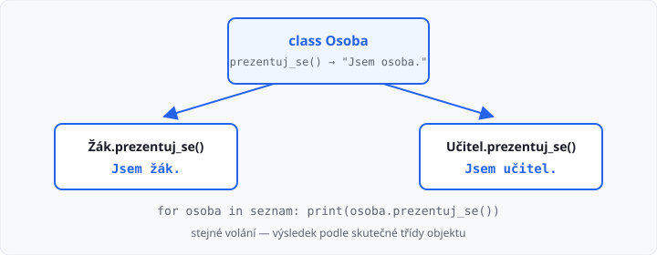

# Polymorfismus

Lekce má **3 hodiny**. Navazuje na [dědičnost](../08-dedicnost/lekce.md). Zbytek týdenní dotace využijte na procvičení polymorfismu.

Minule žák **je** osoba a společné věci patří rodiči. Tady mají potomci **stejnou** metodu, ale **jiné** tělo. Zavoláte `prezentuj_se()` — žák řekne něco jiného než učitel. ŠVP tomu říká *mnohotvárnost*.

## Cíle lekce

- U potomka **přepíšete** metodu, kterou má rodič
- Python vybere tělo podle **skutečného** objektu, ne podle jména v seznamu
- Smíšený seznam projdete **jedním** cyklem — bez `if` podle typu

## Přepis metody

Rodič metodu má. Potomek ji napíše znovu **pod stejným jménem**. Tomu se říká přepis.

```python
class Osoba:
    def __init__(self, jmeno):
        self.jmeno = jmeno

    def prezentuj_se(self):
        return "Jsem osoba."


class Zak(Osoba):
    def prezentuj_se(self):
        return "Jsem žák."


class Ucitel(Osoba):
    def prezentuj_se(self):
        return "Jsem učitel."


print(Zak("Eva").prezentuj_se())          # Jsem žák.
print(Ucitel("Jan").prezentuj_se())       # Jsem učitel.
print(Osoba("x").prezentuj_se())          # Jsem osoba.
```

U žáka se **nepoužije** `prezentuj_se` osoby. Platí to, co je napsané u `Zak`. Rodičovská verze zůstane pro čistou osobu a jako základ, když ji později zavoláte přes `super()`.

Jméno metody musí sedět **přesně**. `oznamit_se` místo `prezentuj_se` není přepis — je to nová metoda navíc a `prezentuj_se` pořád vrací `Jsem osoba.`.

→ viz `priklady/prezentuj_se.py`



## Seznam různých objektů

Do jednoho seznamu dáte žáka i učitele. Cyklus volá **stejnou** metodu. Každá osoba odpoví po svém:

```python
seznam = [Zak("Eva"), Ucitel("Jan"), Zak("Tomáš")]
for osoba in seznam:
    print(osoba.jmeno + ": " + osoba.prezentuj_se())
```

Výstup:

```
Eva: Jsem žák.
Jan: Jsem učitel.
Tomáš: Jsem žák.
```

Proměnná `osoba` je jednou žák, jednou učitel. Nepíšete `if` „když je to žák, vypiš Jsem žák". To by polymorfismus obešlo — a při dalším potomkovi byste museli podmínku doplňovat.

→ viz `priklady/seznam_osob.py`

## super() u přepsané metody

U konstruktoru už `super()` znáte. Stejně ho použijete, když chcete **rodičovské** tělo a k němu něco přidat. Minule šlo `__str__` u žáka opsat celé. Teď rodiče znovu nekopírujte:

```python
class Osoba:
    def __init__(self, jmeno, vek):
        self.jmeno = jmeno
        self.vek = vek

    def __str__(self):
        return self.jmeno + ", věk " + str(self.vek)


class Zak(Osoba):
    def __init__(self, jmeno, vek, rocnik):
        super().__init__(jmeno, vek)
        self.rocnik = rocnik

    def __str__(self):
        return super().__str__() + ", " + str(self.rocnik) + ". ročník"


class Ucitel(Osoba):
    def __init__(self, jmeno, vek, predmet):
        super().__init__(jmeno, vek)
        self.predmet = predmet

    def __str__(self):
        return super().__str__() + ", učitel " + self.predmet


print(Zak("Eva", 14, 2))
print(Ucitel("Jan", 40, "matematiky"))
# Eva, věk 14, 2. ročník
# Jan, věk 40, učitel matematiky
```

`super().__str__()` spustí výpis osoby. Žák jen připojí ročník, učitel připojí předmět. Když se změní `__str__` rodiče, potomkové to zdědí automaticky.

→ viz `priklady/str_super.py`

## Časté chyby

| Chyba | Následek |
|-------|----------|
| jiný název metody než u rodiče | přepis se nekoná, volá se rodič |
| `if` podle typu (žák/učitel) v cyklu | další potomek = další větev, polymorfismus chybí |
| v přepsaném `__str__` znovu skládáte jméno a věk | patří do `super().__str__()` |
| voláte `Zak.prezentuj_se()` bez objektu | chybí `self`, `TypeError` |
| do seznamu dáte třídu (`Zak`) místo instance (`Zak("Eva")`) | volání metody spadne |

## Shrnutí

| Pojem | Význam |
|-------|--------|
| přepis | potomek napíše stejnou metodu znovu, s jiným tělem |
| polymorfismus | stejné volání, výsledek podle skutečné třídy |
| seznam potomků | jeden cyklus, jedna metoda, různé odpovědi |
| `super().metoda()` | nejdřív rodič, pak doplníte svoje |

Příště statické metody a proměnné — členy, které patří třídě, ne jednomu objektu.

Automatický test v AMOS kontroluje **výstup**. Učitel může zkontrolovat, že v cyklu není `if` podle typu a že přepis má stejné jméno metody.

Lekce končí **známkovaným úkolem** s tajným zadáním — dostanete ho od učitele. Hodnotí učitel.

## Co dál

→ [Lekce 10: Statické metody a proměnné](../10-staticke-metody-a-promenne/lekce.md)
