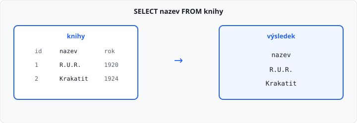

# 16 — SELECT — základy

**5 hodin.** Tabulku už umíte založit. Dnes z ní čtete.

`SELECT` je dotaz. Napíšete, **které sloupce** a **z které tabulky** chcete, a databáze vrátí řádky. Neříkáte jí, jak má tabulku procházet. To je rozdíl proti cyklu v Pythonu z [lekce 14](../14-sql-a-sqlite/lekce.md).

## Cíl

- vypsat jeden sloupec i několik sloupců
- vypsat všechny sloupce pomocí `*`
- pojmenovat sloupec výsledku pomocí `AS`
- spočítat hodnotu výrazem
- vypsat každou hodnotu jen jednou pomocí `DISTINCT`

`WHERE`, řazení a spojení tabulek dnes nepoužíváte. Přijdou v dalších lekcích.

## Jeden sloupec

Tabulka `knihy` má sloupce `id`, `nazev` a `rok`. Řádky do ní v ukázce vložíme příkazem `INSERT`. Ten se podrobně probírá v lekci 22. Dnes z něj potřebujete jen to, že v tabulce nějaké řádky jsou.

```sql
CREATE TABLE knihy (
    id INTEGER PRIMARY KEY,
    nazev TEXT NOT NULL,
    rok INTEGER
);

INSERT INTO knihy (id, nazev, rok) VALUES (1, 'R.U.R.', 1920);
INSERT INTO knihy (id, nazev, rok) VALUES (2, 'Krakatit', 1924);
```

Názvy knih:

```sql
SELECT nazev FROM knihy;
```

| nazev |
|-------|
| R.U.R. |
| Krakatit |

Za `SELECT` je seznam sloupců. Za `FROM` je tabulka. Příkaz končí středníkem.

`id` a `rok` ve výsledku nejsou, protože jste je nevypsali. V tabulce pořád leží.

→ viz `priklady/nazvy.sql`

## Pořadí sloupců

Sloupce ve výsledku jdou v pořadí, v jakém je napíšete. Na pořadí v `CREATE TABLE` to nesedí samo od sebe.

```sql
SELECT rok, nazev FROM knihy;
```

| rok | nazev |
|-----|-------|
| 1920 | R.U.R. |
| 1924 | Krakatit |

Nejdřív je rok, potom název. V tabulce je název před rokem. Rozhoduje seznam za `SELECT`.

→ viz `priklady/sloupce.sql`

## Všechny sloupce

Hvězdička znamená všechny sloupce tabulky, v pořadí z `CREATE TABLE`.

```sql
SELECT * FROM knihy;
```

| id | nazev | rok |
|----|-------|-----|
| 1 | R.U.R. | 1920 |
| 2 | Krakatit | 1924 |

`SELECT *` se hodí, když si tabulku chcete prohlédnout. V úkolu ho nepoužívejte, když zadání vyjmenuje sloupce. Hvězdička by přibrala i ty, které zadání nechce.

## Nové jméno sloupce

`AS` přejmenuje sloupec **ve výsledku**. V tabulce se sloupec nejmenuje jinak.

```sql
SELECT nazev AS kniha FROM knihy;
```

| kniha |
|-------|
| R.U.R. |
| Krakatit |

Hlavička je `kniha`. Hodnoty jsou pořád z sloupce `nazev`.

→ viz `priklady/alias.sql`

## Výraz

Za `SELECT` nemusí být jen jméno sloupce. Může tam být výpočet. Texty spojíte operátorem `||`. Čísla sčítáte a násobíte jako v Pythonu.

```sql
SELECT nazev || ' (' || rok || ')' AS kniha FROM knihy;
```

| kniha |
|-------|
| R.U.R. (1920) |
| Krakatit (1924) |

`rok` je `INTEGER`. Ve spojení textů z něj SQLite udělá text. Nový sloupec v tabulce nevznikne. Hodnota žije jen ve výsledku dotazu.

→ viz `priklady/vyraz.sql`

## Každá hodnota jednou

`DISTINCT` zahodí opakované řádky výsledku. Stejná hodnota zůstane jednou, na místě, kde se v tabulce objevila poprvé.

```sql
CREATE TABLE zamestnanci (
    id INTEGER PRIMARY KEY,
    jmeno TEXT NOT NULL,
    mesto TEXT NOT NULL
);

INSERT INTO zamestnanci (id, jmeno, mesto) VALUES (1, 'Eva', 'Brno');
INSERT INTO zamestnanci (id, jmeno, mesto) VALUES (2, 'Karel', 'Praha');
INSERT INTO zamestnanci (id, jmeno, mesto) VALUES (3, 'Anna', 'Brno');
```

```sql
SELECT DISTINCT mesto FROM zamestnanci;
```

| mesto |
|-------|
| Brno |
| Praha |

Bez `DISTINCT` by Brno bylo ve výsledku dvakrát. `DISTINCT` se píše hned za `SELECT`, před seznam sloupců.

→ viz `priklady/distinct.sql`



## Pořadí řádků

Řádky v těchto ukázkách jdou tak, jak šly do tabulky. Pořadí teď neřešte a v úkolu ho nepřerovnávejte. `ORDER BY` je lekce 18.

## Časté chyby

| Chyba | Proč vadí |
|-------|-----------|
| `SELECT knihy FROM nazev` | nejdřív sloupce, potom `FROM` a tabulka |
| `SELECT *` tam, kde zadání chce jeden sloupec | ve výsledku jsou sloupce navíc |
| čárka za posledním sloupcem | `SELECT nazev, rok,` je neplatný příkaz |
| `'nazev'` v seznamu sloupců | uvozovky jsou textová hodnota, ne jméno sloupce |
| `DISTINCT` až za jménem sloupce | píše se `SELECT DISTINCT mesto` |

## Shrnutí

| Pojem | Význam |
|-------|--------|
| `SELECT` | které sloupce vrátit |
| `FROM` | ze které tabulky |
| pořadí sloupců | podle seznamu za `SELECT` |
| `*` | všechny sloupce tabulky |
| `AS` | jméno sloupce ve výsledku |
| <code>&#124;&#124;</code> | spojení textů |
| `DISTINCT` | každý řádek výsledku jen jednou |

## Co dál

→ [Lekce 17: SELECT — WHERE](../17-select-where/lekce.md)
